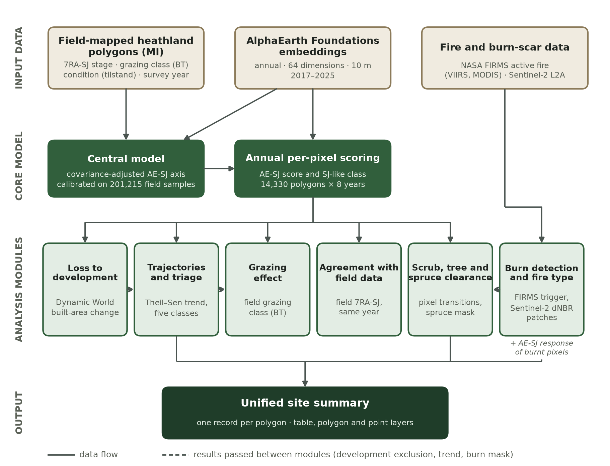

::: {.callout-note appearance="simple"}
This is the methodology appendix of the coastal heathland succession report. It is a living document: it is
updated together with the analysis, and the date above shows when it last changed. Section, table and figure
numbers are kept stable so that references from the report remain valid.
:::

# 1. Purpose and overview {#section-1 .unnumbered}

The workflow described here provides a nationally consistent, spatially explicit assessment of the condition of mapped Norwegian coastal heathland (*kystlynghei*) that can be used to monitor condition changes on an annual basis. Condition is assessed primarily along a management-relevant axis for this semi-natural, culturally maintained ecosystem: the successional gradient from open, actively managed heath towards scrub and woodland that follows the abandonment of traditional burning and grazing. This gradient is formalised in the field-mapping variable *7RA-SJ* (successional stage), which divides heathland into four classes: SJ1, intact; SJ2, fallow phase (*brakkleggingsfase*); SJ3, early regrowth succession phase (*tidlig gjenvekstsuksesjonsfase*); and SJ4, late regrowth succession phase (*sein gjenvekstsuksesjonsfase*).

The method has three objectives:

1.  to translate satellite-derived surface representations into a continuous, field-calibrated succession score (hereafter AE-SJ) for every 10 × 10 m pixel within every mapped heathland polygon, for every year from 2018 to 2025;
2.  to characterise the direction and magnitude of change in each polygon over that period, and to classify polygons as undergoing successional decline, restoration, or no detected substantive change; and
3.  to investigate potential drivers of observed change, where evidence permits, namely grazing, prescribed burning and wildfire, mechanical removal of scrub and trees, and loss of habitat to built development.

The workflow consists of a central calibration model and a set of analytical modules that each address one of these questions ([Figure 1](#figure-1)). All modules operate on the same per-pixel AE-SJ scores, so that condition estimates, trajectories and driver attributions remain internally consistent.

::: {#figure-1}

{width="80%"}

:::

# 2. Data sources {#section-2 .unnumbered}

**Heathland polygons and field assessments.** The spatial units of analysis are the 14,330 coastal heathland polygons mapped according to the *Miljødirektoratets* nature-type mapping programme (*Miljødirektoratets instruks (Miljødirektoratet)*, hereafter MI). Each polygon carries the field-assessed successional stage (7RA-SJ), the year of assessment, an ordinal grazing-pressure class (BT1-BT6) and the overall condition assessment (*tilstand*). A valid 7RA-SJ assessment from the period 2018-2025 is available for 13,853 polygons (96.7 %). For model calibration, polygons were randomly sampled in 0.25 ha patches, yielding 201,215 field-labelled samples (SJ1: 52,224; SJ2: 85,243; SJ3: 42,607; SJ4: 21,141) after the exclusions described in [Section 3](#section-3).

**AlphaEarth Foundations satellite embeddings.** Surface condition was represented by the AlphaEarth Foundations annual satellite embedding dataset (Brown et al. 2025), which summarises a full year of multi-sensor Earth-observation data (including optical, radar, thermal, topographic, climate LiDAR and land cover observations) as a 64-dimensional unit-length vector for each 10 × 10 m pixel. Embeddings were used for each year from 2018 to 2025. Calibration samples were extracted for the year in which each polygon was field-assessed. National annual scoring was performed by reading the embeddings directly from their cloud-hosted public archive, reprojected to a common 10 m grid in ETRS89 / UTM zone 33N (EPSG:25833) with a fixed lattice origin, so that pixels from different years and data sources coincide exactly.

**NASA FIRMS active-fire detections.** Thermal anomaly detections for 2018-2025 were obtained from NASA\'s Fire Information for Resource Management System (NASA) as four standard archive products: the VIIRS instrument (375 m nominal resolution; Schroeder et al. 2014) on NOAA-20 (from April 2018), Suomi NPP and NOAA-21 (from March 2023), and MODIS Collection 6.1 (1 km; Giglio et al. 2016) on Terra and Aqua. Only detections of type 0 (presumed vegetation fire) were used; types 2 (other static land source) and 3 (offshore) make up about two thirds of the Norwegian record. MODIS detections additionally required a detection confidence of at least 30 %. After filtering, the record contained 8,149 detections (3,603 NOAA-20, 3,155 Suomi NPP, 968 NOAA-21 and 423 MODIS).

**Sentinel-2 surface reflectance.** Sentinel-2 Level-2A surface reflectance (European Space Agency) was accessed through the Microsoft Planetary Computer STAC catalogue (Microsoft Open Source) and used to map burn scars. Bands B02, B04, B08 and B12 and the Scene Classification Layer (SCL) were used to compute the Normalised Burn Ratio, NBR = (B08 − B12)/(B08 + B12) (Key and Benson 2006), and the NDVI. Scenes with up to 70 % cloud cover were read and masked per pixel. All tiles of an acquisition date were mosaicked, so that areas crossing a tile boundary are complete, and scenes acquired on or after 25 January 2022 were corrected for the −1000 DN radiometric offset of processing baseline 04.00. All bands were resampled by nearest neighbour to the 10 m analysis grid.

**Dynamic World land cover.** Near-real-time 10 m land-cover probabilities from Dynamic World (Brown et al. 2022) were used to identify conversion of heathland to built surfaces.

**Spruce distribution.** A national 10 m binary mask of *Picea* presence, derived from the Forest Paths tree-genus map (De Keersmaecker et al. 2024), was resampled once onto the analysis grid and used to identify removal of spruce. This dataset is derived on 2020 satellite data.

# 3. Central model: the AE-SJ succession score {#section-3 .unnumbered}

The AE-SJ score is a linear projection of the AlphaEarth embedding onto an axis running from the field-observed SJ4 condition to the field-observed SJ1 condition, after an unsupervised adjustment for the covariance structure of the embedding space.

*Covariance adjustment.* AlphaEarth dimensions are correlated, so that Euclidean or angular distances in the native space are dominated by a few directions of high shared variance. To reduce this, a symmetric whitening transform was estimated from the sample covariance matrix $\mathbf{\Sigma}$ of all complete calibration embeddings ($n$ = 211,882). The covariance matrix was shrunk towards a scaled identity matrix (Ledoit and Wolf 2004),

$$\mathbf{\Sigma}_{\lambda} = (1 - \lambda)\,\mathbf{\Sigma} + \lambda\,{\bar{\sigma}}^{2}\,\mathbf{I},\quad\quad\lambda = 0.20,$$

where ${\bar{\sigma}}^{2}$ is the mean diagonal element of $\mathbf{\Sigma}$, and the adjustment matrix was obtained as $\mathbf{W} = \mathbf{\Sigma}_{\lambda}^{- 1/2}$ by eigendecomposition, with eigenvalues floored at $10^{- 6}$ of the largest eigenvalue to ensure numerical stability. The transform is estimated without reference to SJ labels. Each embedding $\mathbf{x}$ is transformed and re-normalised to unit length, $\mathbf{u} = \mathbf{xW}/\left\| \mathbf{xW} \right\|$.

*Endpoint axis.* Class prototypes $\mathbf{p}_{1}$ and $\mathbf{p}_{4}$ were computed as the unit-normalised mean of the adjusted vectors $\mathbf{u}$ for all SJ1 and all SJ4 calibration samples, respectively, and the succession axis was defined as $\mathbf{d} = (\mathbf{p}_{1} - \mathbf{p}_{4})/\left\| \mathbf{p}_{1} - \mathbf{p}_{4} \right\|$. Samples in grazing classes BT5 and BT6 were excluded from endpoint calibration, because heavy grazing drives heath towards grass-dominated vegetation, a trajectory that is ecologically distinct from, and not represented by, the woody succession gradient that the score is intended to measure. Each sample contributed with equal weight. The prototypes, the calibration anchors, the class medians and standard deviations in [Table 1](#table-1) and all cross-validation metrics are based on the same population of 201,215 samples with a valid 7RA-SJ class outside BT5 and BT6. The covariance adjustment, which does not use SJ labels, was estimated from a larger population: all 211,882 calibration samples with a complete embedding, including the 10,667 samples in BT5 or BT6 or without a valid 7RA-SJ class.

*Calibration.* The raw projection $r = \mathbf{u} \cdot \mathbf{d}$ was linearly rescaled so that the median projection of SJ4 samples maps to 0 and the median projection of SJ1 samples maps to 1:

$$\text{AE-SJ} = \frac{r - {\widetilde{r}}_{SJ4}}{{\widetilde{r}}_{SJ1} - {\widetilde{r}}_{SJ4}}.$$

The score is not truncated; values above 1 or below 0 indicate conditions more open than the typical SJ1 site or more overgrown than the typical SJ4 site, respectively, and are retained for analysis.

*Class boundaries.* For per-pixel classification, the continuous score was partitioned into four SJ-like classes using boundaries placed at the midpoint between the median AE-SJ values of adjacent field classes ([Table 1](#table-1)). The same table provides the class-conditional standard deviations used for uncertainty propagation ([Section 12](#section-12)). These class boundaries are optimised thresholds, used to assess the likely position of an individual pixel along the succession gradient, rather than being modelled succession classes.

::: {#table-1}

| Field class | Median AE-SJ | SD of AE-SJ | Lower boundary of SJ-like class |
|:--|--:|--:|--:|
| SJ1 Intact | 1.000 | 0.182 | 0.927 |
| SJ2 Fallow phase | 0.854 | 0.227 | 0.694 |
| SJ3 Early regrowth | 0.533 | 0.355 | 0.267 |
| SJ4 Late regrowth | 0.000 | 0.348 | — |

: Table 1: AE-SJ reference positions of the four field successional classes, from 201,215 calibration samples, and the derived pixel-classification boundaries.

:::

*Validation.* The model was evaluated under grouped (by parent polygon), leave-one-year-out and spatial-block cross-validation, using rank correlation with the ordinal field class and the separability of the SJ1 and SJ4 endpoints as criteria. In every cross-validation scheme, the covariance adjustment, the endpoint prototypes and the two calibration anchors were re-estimated from the training folds only, and the held-out samples were scored with the model fitted to the training folds, so that no held-out sample contributed to the model used to score it. The parameters of the model, comprising the $64 \times 64$ adjustment matrix, the 64-dimensional direction vector and the two calibration anchors, are fixed and are applied unchanged in all subsequent modules. The full validation results are reported in [Section 11](#section-11).

# 4. Annual national scoring {#section-4 .unnumbered}

For each polygon and each year from 2018 to 2025, all embedding pixels whose centres fall within the polygon were scored with the central model and assigned to an SJ-like class. From these per-pixel values, the following polygon-level quantities were derived for each year: the median, mean and dispersion of AE-SJ; the number and proportion of pixels in each SJ-like class; and the normalised Shannon entropy of those four proportions, as a measure of structural heterogeneity (0 = all pixels in one class; 1 = equal proportions in all four classes).

To characterise change at the pixel level, a baseline score was computed for each pixel as the mean of its separately scored 2018 and 2019 values, and a final score as the mean of its 2024 and 2025 values. Averaging two years at each end reduces the influence of single-year noise in the embeddings. Each pixel was assigned an SJ-like class at baseline and at the final state, giving a 4 × 4 transition matrix per polygon. Transition matrices were accepted for analysis only where at least five valid pixels were available and the transition proportions summed to unity.

# 5. Temporal trajectories and triage classification {#section-5 .unnumbered}

The annual polygon-median AE-SJ series was used to estimate the direction and magnitude of change over the monitoring period. The trend was estimated with the Theil-Sen estimator (Sen 1968), a median-of-pairwise-slopes estimator that is robust to individual outlying years, and expressed as a trend-equivalent change (slope × number of years spanned), where for this version, the numbers of years spanned is seven. Positive values indicate movement towards SJ1-like (more open) structure, and negative values movement towards SJ4-like (more overgrown) structure.

Polygons were then classified into five triage classes by comparing the absolute trend-equivalent change against two thresholds anchored in the field classification rather than in the distribution of observed changes:

- a *moderate* threshold equal to half the AE-SJ distance between the SJ1 and SJ2 medians (0.073 AE-SJ units); and
- a *strong* threshold equal to half the AE-SJ distance between the SJ3 and SJ4 medians (0.267 AE-SJ units).

This gives the classes *strong restoration*, *moderate restoration*, *no strong signal*, *moderate succession* and *strong succession*. Because the thresholds are absolute and ecologically defined, the number of polygons in each class reflects the condition of the population rather than a predetermined quota. The two thresholds are taken from different parts of the gradient on purpose. The SJ1-SJ2 step is the smallest separation between adjacent field classes, so half of it is the smallest change treated as meaningful anywhere on the gradient; the SJ3-SJ4 step is the largest, so half of it marks a substantial change even where the classes are most widely spaced. Both are applied in both directions because the score is treated as a single linear axis, on which a given change has the same meaning towards SJ1 as towards SJ4; the uneven spacing of the class medians ([Table 1](#table-1)) means that this is an approximation. The classification is moderately sensitive to the choice of threshold. Setting the moderate threshold at 0.375 or 0.625 of the SJ1-SJ2 step instead of 0.5 changes the number of succeeding polygons from 4,951 to 5,887 or 4,084 and of restoring polygons from 1,737 to 2,307 or 1,275, and leaves 89-91 % of polygons in the same class; the same change to the strong threshold leaves 95-98 % in the same class. The class *no strong signal* denotes that change did not exceed the moderate threshold in either direction; it does not imply that the polygon was unchanged. Kendall's rank correlation and Benjamini-Hochberg-adjusted *p*-values (Benjamini and Hochberg 1995) are reported for each polygon as diagnostics but are not used for classification, since formal significance testing of eight annual observations after multiple-testing correction has very low statistical power.

**Regional year effects.** Before the trend was fitted, the annual medians were corrected for regional year effects. For each polygon, residuals around its Theil-Sen line were computed from the uncorrected series. In each county and year, the median residual across the county\'s polygons was taken as the year effect and subtracted from the annual medians of all its polygons; Troms, with 35 polygons, was combined with Nordland. Because the effect is measured around each polygon\'s own trend, a trend shared by a whole county is retained, while weather, snow, the timing of the growing season and differences between embedding years that shift a whole county in a given year are removed. The Theil-Sen trend and the triage class were then computed from the corrected series. The largest effects were 0.103 AE-SJ units (Østfold 2020, 57 polygons), 0.096 (Nordland 2025) and 0.081 (Trøndelag 2020). The correction assumes that a real change shared by most polygons of a county in a single year, as opposed to a sustained trend, is rare; such an episodic regional change would be partly removed as a year effect. Its influence on the results is small. Without the correction, 5,001 polygons would be classed as succeeding and 1,782 as restoring, against 4,951 and 1,737 with it; 88.6 % of polygons keep the same triage class, and all changes of class are between neighbouring classes. The year effects of Østfold, the smallest county group, are the least precisely estimated.

**Trend confidence.** The uncertainty of the trend-equivalent change was estimated from the residuals *e~t~* of the corrected series around its Theil-Sen line, with slope *b*, intercept *a* equal to the median of *y~t~* − *bt*, and residual variance *s*² = Σ*e~t~*² / *d*, where *d* = *n* − 2. With eight annual values this variance is poorly determined for a single polygon, so it was moderated by empirical Bayes (Smyth 2004). Polygons were grouped by county (Troms with Nordland, Østfold with Agder) and by SJ-like class at the start of the period, with groups of fewer than 30 polygons merged to county level, giving 24 groups. Each polygon\'s variance was replaced by *s̃*² = (*d~0~* *s~0~*² + *d s*²) / (*d~0~* + *d*), where *s~0~*² is the prior variance of its group and the prior degrees of freedom *d~0~* (16.5) were estimated from how much more the polygon variances vary than sampling alone would produce. The standard error of the slope is *s~b~* = √(*s̃*² / Σ(*t* − *t̄*)²), and the 90 % confidence interval of the trend-equivalent change is (*b* ± *t~0.95,\ d+d0~* *s~b~*) × the number of years spanned. Each polygon in a succession or restoration class was assigned a confidence level: high where the interval lies wholly beyond the moderate threshold on the side of its class, so that at least a moderate change in that direction is supported; medium where the interval excludes zero, so that the direction but not the size of the change is supported; and low where the interval includes zero. Polygons with no strong signal were given no confidence level, since eight annual values cannot show that a polygon has changed by less than the moderate threshold. The interval does not include the calibration uncertainty of the score ([Section 12](#section-12)), which mainly affects the level of a polygon\'s score rather than its trend. The confidence level is used to report how many polygons in each class have a well-supported trend; it does not change the triage class itself. The standard error is the ordinary least-squares formula applied to the residuals around the Theil-Sen line. It approximates the sampling distribution of the Theil-Sen slope, and it assumes independent annual residuals, so it does not account for temporal autocorrelation or for the uncertainty of the estimated year effects.

Polygons were excluded from triage where (i) the grazing class was BT5 or BT6 (for the reason given in [Section 3](#section-3)); (ii) any persistent conversion to built land was detected ([Section 9](#section-9)); (iii) fewer than six years of valid scores were available; or (iv) any year-to-year change in the polygon median exceeded 0.5 AE-SJ units, which was considered physically implausible for a whole-polygon statistic and indicative of a data artefact. The 0.5 limit is close to the SJ3-SJ4 step (0.533), a move of the whole polygon median by about a full class in one year, and lies near the 99.9th percentile of the largest annual step of each polygon (median 0.13). Of the 14,330 polygons, 53 were excluded under (i) and 273 under (ii) (326 in total), 7 had no year with enough valid pixels, 16 were excluded under (iv) and none under (iii), leaving 13,981 polygons for triage. A rapid real intervention could also produce a large one-year change, so (iv) may remove some genuine changes, but it affects only 16 polygons.

For each polygon that crossed the moderate threshold, the transition matrix was used to describe the spatial character of the change. Change was described as *widespread* where at least 50 % of matched pixels crossed an SJ-like class boundary and at least 75 % of the crossing pixels moved in the same direction as the polygon-level trend, and as *localised* otherwise. Widespread, directionally coherent change is consistent with a polygon-wide driver (for example, a change in grazing regime), whereas change confined to part of a polygon is consistent with a localised intervention or disturbance. These descriptors are reported as spatial evidence and are not by themselves taken as proof of cause. Polygon-level trajectory results are cross-tabulated against the field condition assessment (*tilstand*).

# 6. Grazing pressure and rate of succession {#section-6 .unnumbered}

To assess whether recorded grazing is associated with a reduced rate of succession, the trend-equivalent change was compared between polygons with no recorded sign of grazing (BT1) and polygons with grazing present (BT2-BT3). Because the distribution of change is skewed and heavy-tailed, the comparison used a two-sided Wilcoxon rank-sum test (Wilcoxon 1945; Mann and Whitney 1947), with the Hodges-Lehmann estimator (Hodges and Lehmann 1963) and its 95 % confidence interval as the effect size, expressed in AE-SJ units. Since the BT classes contribute to the official *tilstand* assessment, the comparison was repeated within *tilstand* strata and within the subset of polygons that started the period in SJ1 or SJ2, to examine whether the association persists after accounting for recorded condition and initial successional stage.

# 7. Burn detection {#section-7 .unnumbered}

The burn mapping is triggered by FIRMS: a burn can only be mapped where FIRMS has detected a fire, so it is not a complete inventory of burning. In the validation against registered burning ([Section 11.4](#section-11-4)), FIRMS detected a fire at 20 % of the registered burning sites; where it did and Sentinel-2 imagery was usable, the burn scar was found for 77 % of the fires (apparent performance on the fires used to choose the thresholds). Overall, a burn scar was mapped at 19 of the 127 registered burning sites (15 %). Potential burn events at MI-mapped sites were identified and characterised as follows. First, FIRMS data flags whether a fire has been detected within the area of a kystlynghei site, after which Sentinel-2 imagery is used to map the burn scar using the normalised burn ratio (NBR), with the area of the burn scar within each MI mapped site registered along with the change in AE-SJ score within the burnt area relative to the unburnt area. Detection proceeds in five steps; the parameters are listed in [Table 2](#table-2). The dNBR, vegetation and area thresholds were chosen by testing the method against burning registered in naturtiltak ([Section 11.4](#section-11-4), [Table 8](#table-8)).

1.  **Fire events.** FIRMS detections within reach of an MI polygon, 750 m for VIIRS (two 375 m pixels) and 1,000 m for MODIS (one pixel), were linked to it. The reach allows for the detection being recorded at the pixel centre, up to several hundred metres from the fire. Linked detections of the same year lying within 2 km and 30 days of each other were grouped into fire events (single linkage). Each event was mapped once, over a rectangle covering its detections buffered by their reach and all MI polygons linked to it, plus 100 m. Because grouping is by single linkage, one event can contain several fires and be linked to several sites. Events were not split, but their duration was checked: most of the 264 events consisted of detections on a single date, and the longest spanned 27 days. 226 events were linked to more than one MI polygon (median 5, maximum 56), because MI polygons are often small and close together. Burns are attributed to individual polygons in step 5, so grouping affects the area mapped for an event, not which polygons are recorded as burnt.
2.  **Pre- and post-fire composites.** For an event first detected on date t, the per-pixel median NBR and NDVI were computed from clear observations within ±45 days of the same calendar date in the previous year (pre-fire), and from 1 to 60 days after t (post-fire). Clear observations were pixels classified by the SCL as vegetation or bare soil (classes 4 and 5), eroded by two pixels to remove cloud and shadow edges. Where fewer than two clear observations were available, the windows were widened once, to ±75 and 90 days; pixels with fewer than two observations in either window were left unclassified. The same-season pre-fire window avoids reading spring green-up or autumn senescence as a burn, and the short post-fire window captures the scar before the heath regrows. Burnt pixels that the SCL assigns to other classes, for example dark area pixels or unclassified, are not used, which may reduce the mapped area of severely burnt patches. The erosion was applied to the clear mask as a whole, so it also removes two pixels at the edges of other excluded surfaces, such as water. Of the 264 FIRMS events, 6 (2 %) had fewer than two clear observations in a window after widening and could not be mapped; the windows were widened for 8 events.
3.  **Change and correction.** dNBR = NBR*pre* − NBR*post* and dNDVI = NDVI*pre* − NDVI*post* were corrected for differences between the two windows that affect the whole area, such as phenology, illumination and differences between years, by subtracting the unburnt mode of the change over the MI heath pixels in the area: the peak of the histogram (0.01 bins, five-bin moving average) of the less green 80 % of pixels by pre-fire NDVI, refined as the median of the values within ±0.10 of the peak. Pixels brighter in B02 than the 95th percentile of the heath pixels\' mean over April of the previous year were excluded, to suppress bright, non-vegetated surfaces.
4.  **Classification.** A pixel was a burn candidate where the corrected dNBR was at least 0.075, the corrected dNDVI was not negative, the pre-fire NDVI was at least 0.15 and the post-fire NBR did not exceed 0.30. The vegetation floor excludes bare rock and water but retains dormant heather, whose NDVI in late winter is low. Connected regions of candidates (8-connectivity) were kept where they contained at least four pixels with a corrected dNBR of at least 0.20, so that weak burn margins are grown from a clearly burnt core while isolated weak anomalies are discarded. Gaps of one pixel were closed (morphological closing) to group patchy burns, and patches with at least 0.25 ha of candidate pixels were retained. These thresholds were chosen against registered burns ([Section 11.4](#section-11-4), [Table 8](#table-8)). Because the same fires were used to choose the thresholds and to report detection, the detection rates in [Section 11.4](#section-11-4) are apparent performance on the tuning set and may overstate the sensitivity for independent burns. The candidate and core thresholds lie below the bounds of low (0.10) and moderate (0.27) burn severity of Key and Benson (2006), because prescribed burns of heath are mostly of low severity.
5.  **Attribution to fires and sites.** A patch was accepted as a burn when at least one of its pixels lay within reach of one of the event\'s FIRMS detections. This reduces the risk of attributing unrelated disturbance elsewhere in the mapped area, such as forest felling, which produces a similar drop in NBR. An MI polygon with at least 0.1 ha of burn pixels inside it was recorded as burnt in that year. The burn pixels were written to the polygon\'s own 10 m grid, which shares the lattice of the AE-SJ scoring, and burns from several events in one year were merged.

::: {#table-2}

| Parameter | Value | Purpose |
|------------------------|------------------------|------------------------|
| FIRMS reach (VIIRS / MODIS) | 750 m / 1,000 m | link detection to polygon and to burn patch |
| Event grouping | 2 km, 30 days | detections of the same fire |
| Pre-fire window | ±45 (75) days, previous year | same season as the fire |
| Post-fire window | 1-60 (90) days after detection | before regrowth |
| Clear observations | SCL 4-5, eroded 2 px; ≥ 2 per window | cloud and shadow edges |
| Brightness mask | B02 \> 95th percentile, April of previous year | bright bare surfaces |
| Corrected dNBR (candidate / core) | ≥ 0.075 / ≥ 0.20 | burn candidate / burnt core |
| Corrected dNDVI | ≥ 0 | vegetation did not get greener |
| Pre-fire NDVI | ≥ 0.15 | vegetated pixels only |
| Post-fire NBR | ≤ 0.30 | charred or bare surface |
| Core pixels per region | ≥ 4 | remove isolated anomalies |
| Morphological closing | 1 pixel | group patchy burns |
| Minimum patch | 0.25 ha | minimum mapping unit |
| Minimum burn in a polygon | 0.1 ha | site burnt in that year |

: Table 2: Parameters of the Sentinel-2 burn mapping ([Section 7](#section-7)). Values in brackets apply where the standard window has fewer than two clear observations. The dNBR, NDVI, patch and site thresholds were chosen against burning registered in naturtiltak ([Section 11.4](#section-11-4), [Table 8](#table-8)).

:::

When scrub and tree removal ([Section 8](#section-8)) is attributed to a burn rather than to clearance, scrub pixels (SJ3-like, outside the spruce mask) that lie within a burn mapped in any year from 2018 to 2025 are attributed to the burn. Tree pixels (SJ4-like, or in the spruce mask) are attributed to clearance inside prescribed burns, for two reasons. First, prescribed burning is applied to heath that is still open: in the 25 registered burns of [Section 11.4](#section-11-4) ([Figure 3](#figure-3)), 84 % of the burnt cells were SJ1- or SJ2-like before burning and none were SJ4-like, and spruce is not removed by intentional burning. Second, felling produces the same drop in NBR as burning, so the two cannot be separated where clearance and a burn take place at the same site in the same year. This is common, because measures are often combined. At one site, invasive-species removal and burning were both registered in 2021. Uncontrolled summer fires, however, can kill trees, so tree pixels inside the burn of a probable wildfire are attributed to the burn. Pixels attributed to a burn may still have been cleared rather than burnt, and are therefore reported as coinciding with a burn, not as burnt.

**Prescribed burning versus wildfire.** Each burn was given a provisional fire type from the acquisition dates of the FIRMS detections of the events that burnt it. A burn was classed as a probable wildfire where at least one of these detections fell in June, July or August, and as a probable prescribed burn where all fell outside these months.

The rule rests on the timing of lyngbrenning, which is carried out outside the growing season, in practice in late winter and spring, so a fire detected in the summer months is more likely to be uncontrolled. Because the clearance outputs are not split by burn year, the area coinciding with a burn on polygons with both a spring burn and a summer fire ([Section 8](#section-8)) cannot be assigned to one fire type and is reported with the summer-fire polygons.

The season rule has two known limitations. First, wildfires in spring, for example escaped burns or fires lit outside the permitted period in a dry spell, are classed as prescribed burns. Second, only burns detected by FIRMS are classed, and FIRMS misses most small prescribed burns ([Section 11.4](#section-11-4)), so the ratio of prescribed burns to wildfires is underestimated.

The separation will be developed further in 2027 with evidence on the cause of each fire: matching against registered burning (naturtiltak, and lyngbrenning registered by Landbruksdirektoratet), fire-incident records from the fire and rescue services (DSB\'s BRIS database) and burn severity from the dNBR maps.

**Response of the succession score to burning on MI sites.** For each burn on an MI polygon, the AE-SJ score ([Section 3](#section-3)) of the burnt pixels and of the polygon\'s pixels that were never burnt (in any year) was computed for every year from 2018 to 2025. The effect of the burn in year k relative to the burn is the burnt-reference difference in year k minus the difference in the year before the burn, as in the analysis of registered burns ([Section 11.4](#section-11-4)). The burn year itself was excluded, burns with fewer than 20 pixels in either group were left out, each burn was weighted equally, and 95 % confidence intervals were computed across burns (t distribution), separately for probable prescribed burns and probable wildfires. The SJ-class composition of the burnt pixels was summarised for the year before and the year after the burn. Results are reported in the condition report; burns in the final year of the series cannot yet be assessed.

# 8. Scrub and tree clearance, including spruce removal {#section-8 .unnumbered}

Potential removal of scrub and trees was inferred from the pixel transition matrix ([Section 4](#section-4)) as pixels that moved from an SJ3-like or SJ4-like class at baseline (2018-2019) to an SJ1-like or SJ2-like class at the final state (2024-2025). Pixels in the national Picea mask were counted as tree removal whatever their SJ-like class, since spruce are trees; the other transitions from SJ4-like were also counted as tree removal, and the remaining transitions from SJ3-like as scrub removal. Scrub pixels within a burn mapped in any year from 2018 to 2025, and tree pixels within the burn of a probable wildfire ([Section 7](#section-7)), were reported as coinciding with a burn. All other transitioning pixels were classified as potential clearance. A single polygon may contain both.

Removal of spruce was quantified as the transitioning pixels that coincide with the national *Picea* mask; it is part of tree removal and is also reported on its own. Spruce removal is attributed to clearance except inside the burns of probable wildfires ([Section 7](#section-7)). The percentage of each polygon\'s area covered by spruce is reported separately as context.

Clearance is reported for two populations that answer different questions. The first provides the headline estimate of restoration through clearance (999 polygons in the present assessment); the second is used for the site-level inventory:

- the subset of polygons whose overall trajectory was classified as moderate or strong restoration ([Section 5](#section-5)) and that contain at least one SJ3/SJ4 → SJ1/SJ2 pixel transition. In these polygons, the pixel-level evidence and the independent polygon-level trend agree, which makes this the conservative estimate of restoration through clearance. Both populations are limited to the polygons that entered the triage (13,981; [Section 5](#section-5)), so polygons in BT5 or BT6, with development or failing the quality checks are not included. Of the 1,737 restoring polygons, 1,730 had valid transition data and 999 at least one such transition, covering 707 ha. A single transitioning pixel (0.01 ha) is within the noise of the method: 66 of the 999 polygons have only one, and 603 have at least 0.1 ha; and
- all polygons with valid transition data and at least one such transition, regardless of the polygon-level trend. In the present assessment, 4,525 polygons have at least one transition (2,019 ha), of which 3,006 (1,252 ha) have no strong signal and 520 (61 ha) are classed as succeeding. This population captures clearance confined to part of a polygon that is not large enough to shift the polygon median, and is used for the site-level inventory ([Section 13](#section-13)).

# 9. Loss of habitat to development {#section-9 .unnumbered}

Conversion of heathland to built surfaces was identified from Dynamic World (Brown et al. 2022) as pixels within MI polygons that transitioned persistently from a natural land-cover class to the built-area class, so that single-year misclassifications were not counted. Lost area was summarised per polygon for 2016-2020 and 2021-2025, and aggregated nationally and by county (*fylke*). Polygons with any detected persistent development were excluded from the trajectory analysis, so that the conversion of heath to built land is not misinterpreted as a change in successional stage.

# 10. Agreement with field assessment {#section-10 .unnumbered}

As an operational agreement assessment of the per-pixel classification, in addition to the cross-validation of the model, the field-assessed 7RA-SJ class of each polygon was compared with the modal SJ-like class of that polygon's pixels in the year of field assessment. This comparison was made for every polygon with a valid field assessment in the period 2018-2025 and a valid satellite score for the same year. Agreement was summarised as a confusion matrix, overall exact agreement, Cohen's κ (Cohen 1960) and class-specific recall. The comparison is not independent of the calibration: the calibration samples were drawn from the same polygons and carry the same field labels. It therefore describes how well the operational product reproduces the field record, not its performance at sites not used in calibration; the latter is estimated by the cross-validation ([Section 11.1](#section-11-1)).

In addition, the burn and clearance signals were evaluated against management actions independently reported in the Norwegian Environment Agency's register of nature management measures (*naturtiltak*). For registered prescribed burns, AE-SJ trajectories were compared before and after the treatment year, relative to untreated reference areas, and the detection of registered burns by the burn method was assessed ([Section 11.4](#section-11-4)). For registered scrub and tree clearance, the proportion of registered actions accompanied by a detectable AE-SJ clearance response was calculated, stratified by the type of action.

# 11. Validation results {#section-11 .unnumbered}

The model and its operational outputs were validated at three levels: (i) cross-validation of the model on the 0.25 ha calibration samples; (ii) agreement between the operational per-pixel classification and the field assessment of each polygon in the year of survey; and (iii) detection of independently registered management actions. All sample-level metrics are reported for samples outside grazing classes BT5 and BT6, which form the population for which the score is intended.

## 11.1 Cross-validation {#section-11-1 .unnumbered}

Four metrics were computed on held-out data. Spearman's rank correlation ($\rho$) between the score and the ordinal field class measures how well the score reproduces the full SJ1-SJ4 ordering. The area under the receiver operating characteristic curve (AUC) (Hanley and McNeil 1982) for SJ1 against SJ4 samples measures discrimination between the two endpoints. Endpoint separation is the difference between the held-out median scores of SJ1 and SJ4 samples; on the calibrated scale a value of 1 indicates that the training anchors were reproduced exactly. The fourth metric records whether the four class medians were strictly ordered (SJ1 \> SJ2 \> SJ3 \> SJ4). Grouped cross-validation used five folds defined by parent polygon, repeated twice (10 folds); leave-one-year-out cross-validation withheld each survey year from 2018 to 2025 in turn (8 folds); and spatial-block cross-validation withheld five geographically contiguous blocks of parent polygons (5 folds).

::: {#table-3}

| Validation | Folds | $\rho$​ | AUC | Endpoint separation | Medians ordered |
|----------------------|-------:|----------:|----------:|----------:|----------:|
| Grouped by parent polygon | 10 | 0.662 (0.035) | 0.990 (0.005) | 0.987 (0.075) | 10 of 10 |
| Leave one year out | 8 | 0.633 (0.104) | 0.988 (0.008) | 0.939 (0.155) | 8 of 8 |
| Spatial block | 5 | 0.582 (0.087) | 0.983 (0.012) | 0.915 (0.138) | 5 of 5 |
| All samples (fitted model) | \- | 0.680 | 0.991 | 1.000 | yes |

: Table 3: Cross-validated performance of the AE-SJ model. Values are means across folds, with the standard deviation across folds in parentheses. $\rho$, Spearman's rank correlation with the ordinal field class; AUC, discrimination of SJ1 from SJ4 samples. The final row gives the in-sample fit to all 201,215 calibration samples.

:::

The model reproduced the ordering of the four field classes in every fold of every validation scheme ([Table 3](#table-3)). Discrimination between the endpoint classes was consistently high (mean AUC 0.983-0.990), and rank correlation with the ordinal field class ranged from 0.582 to 0.662 on held-out data, against 0.680 in the fitted model. The AUC measures only the separation of the two endpoint classes. The four stages are separated much less well: the operational four-class agreement with the field assessment was 50.8 % exact and 94.2 % within one class ([Section 11.2](#section-11-2)). The similarity between grouped cross-validation and the in-sample fit suggests limited apparent overfitting under this validation scheme; lower spatial-block performance indicates reduced transferability to withheld regions. Endpoint separation close to 1 shows that the calibration anchors are largely preserved on held-out data. Performance was lowest under spatial-block cross-validation, as expected when entire regions are withheld, but remained high for endpoint discrimination. Fitted to all calibration samples, the class medians were 1.000, 0.854, 0.533 and 0.000 for SJ1-SJ4 ([Table 1](#table-1)).

::: {#table-4}

| Withheld year | Samples | $\rho$​ |   AUC | Endpoint separation |
|---------------|--------:|-------:|------:|--------------------:|
| 2018          |  14,513 |  0.529 | 0.994 |               0.969 |
| 2019          |  19,988 |  0.519 | 0.970 |               0.695 |
| 2020          |  29,799 |  0.719 | 0.991 |               1.094 |
| 2021          |  31,892 |  0.685 | 0.992 |               1.134 |
| 2022          |  28,735 |  0.803 | 0.996 |               1.048 |
| 2023          |  35,487 |  0.523 | 0.985 |               0.855 |
| 2024          |  21,271 |  0.628 | 0.987 |               0.946 |
| 2025          |  19,530 |  0.659 | 0.984 |               0.773 |

: Table 4: Leave-one-year-out performance of the AE-SJ model for each withheld survey year.

:::

When individual survey years were withheld ([Table 4](#table-4)), rank correlation ranged from 0.519 (2019) to 0.803 (2022), and the AUC was at least 0.970 in every year. Class medians were strictly ordered in every withheld year. Endpoint separation varied between 0.70 and 1.13, indicating that the spacing of the field classes on the AE-SJ scale differs to some degree between embedding years. Inter-annual variation of this kind is one reason why trends are estimated with a robust estimator over eight years, and why single-year changes are not interpreted in isolation ([Section 5](#section-5)).

## 11.2 Agreement with field assessment {#section-11-2 .unnumbered}

The field-assessed 7RA-SJ class was compared with the modal SJ-like pixel class in the year of survey for 13,846 polygons (96.6 % of all mapped polygons), each assessed once between 2018 and 2025 ([Table 5](#table-5)). Overall exact agreement was 50.8 %, with Cohen's $\kappa$ = 0.333. Because the classes are ordinal, a linearly weighted $\kappa$, which gives partial credit to near misses, was also computed; it was 0.508. Agreement to within one class was 94.2 %, and the rank correlation between field and modal class was 0.674. Gross misclassification was rare: 30 polygon-years (0.2 %) were assigned to the opposite endpoint class (SJ1 as SJ4, or vice versa).

::: {#table-5}

| Field class   | Modal SJ1 | Modal SJ2 | Modal SJ3 | Modal SJ4 |  Total | Recall (%) |
|-----------|----------:|----------:|----------:|----------:|----------:|----------:|
| SJ1           | **1,057** |       538 |       163 |         9 |  1,767 |       59.8 |
| SJ2           |     1,027 | **1,776** |     1,516 |       196 |  4,515 |       39.3 |
| SJ3           |       256 |       706 | **2,030** |     1,217 |  4,209 |       48.2 |
| SJ4           |        21 |       155 |     1,002 | **2,177** |  3,355 |       64.9 |
| Total         |     2,361 |     3,175 |     4,711 |     3,599 | 13,846 |            |
| Precision (%) |      44.8 |      55.9 |      43.1 |      60.5 |        |            |

: Table 5: Confusion matrix of field-assessed 7RA-SJ class (rows) against the modal satellite-derived SJ-like class of the same polygon in the year of survey (columns). Exact agreement is shown in bold.

:::

Agreement was highest for the endpoint classes (recall 59.8 % for SJ1 and 64.9 % for SJ4) and lowest for the intermediate fallow class SJ2 (39.3 %), which was assigned in similar proportions to the neighbouring classes SJ1 and SJ3. This pattern is expected for an ordinal gradient on which the intermediate classes occupy overlapping ranges of the score ([Table 1](#table-1)). It is compounded by two features of the comparison: the field assessment describes the polygon as a whole, whereas the modal class summarises a pixel distribution that may be structurally heterogeneous; and the field classification itself carries observer uncertainty. Most disagreements are therefore between adjacent stages, consistent with partial preservation of the ordinal successional gradient.

All 30 polygons with gross disagreement were inspected on aerial photographs from the survey year (Esri World Imagery Wayback; Esri). In several of these, the imagery contradicts the field record and supports the satellite classification ([Figure 2](#figure-2)). Polygons recorded in the field as intact heath (SJ1) were covered by closed woodland, and polygons recorded as late regrowth (SJ4) were open, recently cleared or exposed coastal heath on bare rock. In the remaining cases, mostly very small polygons comprising isolated tree clumps within open heath, the imagery supports the field record. There the disagreement arises because the 10 m embeddings also integrate the surrounding open vegetation. These examples suggest that gross disagreements can reflect both inconsistencies in field records and the limited ability of 10 m data to resolve very small polygons.

::: {#figure-2}

![Figure 2: Examples of gross disagreement in which aerial imagery from the survey year supports the satellite classification rather than the field record. The polygon is outlined in red. (a, b) Polygons recorded as intact (SJ1) in the field are covered by closed woodland, consistent with the modelled SJ4 class. (c, d) Polygons recorded as late regrowth (SJ4) are open, consistent with the modelled SJ1 class: (c) a recently cleared area and (d) coastal heath on exposed rock. Imagery: Esri World Imagery Wayback.](img/methods_fig2.png){width="85%"}

:::

## 11.3 Detection of registered management actions {#section-11-3 .unnumbered}

Of the 229 registered scrub and tree clearance actions examined, 160 (69.9 %) were followed by a detectable AE-SJ clearance response within the reported intervention window ([Table 6](#table-6)). Detection was highest for tree clearance (86 %), consistent with the larger structural contrast between SJ4-like woodland and open heath, and lower for scrub clearance (70 %), combined scrub and tree clearance (65 %) and actions of unspecified type (64 %).

::: {#table-6}

| Registered action           | Actions | Detected | Detection rate (%) |
|-----------------------------|--------:|---------:|-------------------:|
| Scrub clearance             |      80 |       56 |                 70 |
| Tree clearance              |      36 |       31 |                 86 |
| Scrub and tree clearance    |      46 |       30 |                 65 |
| Clearance, type unspecified |      67 |       43 |                 64 |
| All clearance actions       |     229 |      160 |                 70 |

: Table 6: Detection of registered scrub and tree clearance actions (naturtiltak) by the AE-SJ clearance response.

:::

## 11.4 Validation of burn detection against registered burning {#section-11-4 .unnumbered}

The burn methods were tested against burning registered in naturtiltak, the grant scheme for measures in threatened nature types, which holds 223 polygons with burning registered in 2021--2025. The registered year is usually the year the measure was reported, at the end of a grant period, so the burning may have been done in that year or in any year before it. The final reports show that not every registered burn was carried out: 32 registrations report only clearing, grazing, burning of brush or cut material, or burning postponed by the weather. These were removed, except two whose reports state that the heath had been burnt in earlier years, confirmed by FIRMS. Of the remaining 193 registrations, 71 have a final report (68 confirming burning at the site, two reporting burning in earlier years, confirmed by FIRMS, and one unclear) and 122 have no final report in the register. Registrations overlapping by more than 90 % (of the smaller polygon) are the same site registered again and were merged, giving 127 features.

**Detection by FIRMS**. FIRMS detected a fire at 26 of the 127 registered burning sites (20 %), almost all in the lyngbrenning season (February-April). Detection depended strongly on size ([Table 7](#table-7)): 6 of 46 sites under 5 ha were detected, against 8 of 18 over 100 ha. The burnt areas given in the final reports show the same pattern: a burn had about a 50 % chance of detection at around 17 ha. Small, short or low-intensity burns, typical of lyngbrenning, are often over before a satellite passes or too weak to register. Registrations without a final report need not have been burnt, which would bias the 20 % detection rate downwards. Among the 40 features with a report confirming burning, FIRMS detected a fire at 13 (33 %), against 12 of 74 (16 %) with no report but a grant paid and 1 of 13 with no report and no grant paid.

::: {#table-7}

| **Registered area** | **Features** | **FIRMS fire detected** | **dNBR burn scar (of FIRMS)** |
|------------------|------------------|------------------|------------------|
| \< 5 ha | 46 | 6 (13 %) | 3 (50 %) |
| 5-20 ha | 31 | 4 (13 %) | 3 (75 %) |
| 20-100 ha | 32 | 8 (25 %) | 5 (62 %) |
| \> 100 ha | 18 | 8 (44 %) | 8 (100 %) |
| **All** | **127** | **26 (20 %)** | **19 (73 %)** |

: Table 7: Registered burning (naturtiltak, 2021--2025, after removing registrations whose reports show that no burning was done, duplicates merged) by size of the registered area: features with a FIRMS detection in any year up to and including the registered year, and of these, features where Sentinel-2 dNBR showed the burn scar.

:::

**Burn scars.** Each FIRMS fire was mapped with the method in [Section 7](#section-7). Registered polygons are roughly drawn, so a scar inside the polygon or within 250 m of it counted as a hit. The 26 sites with a FIRMS detection had 37 fires between them: a site can have fires in several years, and a fire within reach of neighbouring sites counts as a fire at each of them (25 distinct fires). A burn scar was found for 26 of the 37 fires (70 %), 17 inside the polygon and 9 within 250 m, and for 23 of the 30 with clear Sentinel-2 imagery (77 %). Of the other 11 fires, 6 had a scar only 250-750 m from the polygon, 4 had no usable imagery and 1 had no scar. At site level, 19 of the 26 sites had at least one fire with a scar ([Table 7](#table-7)).

**Response of the succession score to burning.** In 25 registered burns, the AE-SJ score of the burnt and unburnt parts was compared from two years before to four years after burning ([Figure 3](#figure-3)). The two were similar before the burn. Afterwards the burnt part moved towards SJ1 by about 0.10 in the first year and 0.11--0.16 in later years, roughly from SJ2-like to SJ1-like. This is about one class step, similar to the effect of scrub clearance and to the year-to-year variation in the score. The AE-SJ score alone is therefore insufficient for reliable burn detection, so burns are mapped independently of it ([Section 7](#section-7)).

::: {#figure-3}

{width="85%"}

:::

**Choice of thresholds.** The thresholds in [Section 7](#section-7) ([Table 2](#table-2)) were chosen by testing 216 combinations on these fires and comparing scars found against false detections at control sites: copies of each registered polygon and its detections moved 5 km in a random direction (centroid on land) and mapped at the same date ([Table 8](#table-8)). With the chosen thresholds, a scar was found inside 4 of the 32 control sites (12.5 %) and within 250 m of 8 (25 %). The dNBR thresholds mattered most, because prescribed heath burns are mostly of low severity.

::: {#table-8}

| **Setting** | **dNBR candidate / core** | **Minimum patch (ha)** | **Minimum burn in polygon (ha)** | **Pre-fire NDVI** |
|-----------|-----------|-----------|-----------|-----------|
|  | 0.075 / 0.20 | 0.25 | 0.1 | 0.15 |

: Table 8: Threshold settings tested on the FIRMS fires at registered burning sites: burn scars inside the registered polygon and false detections at the control sites. Post-fire NBR ≤ 0.30 throughout.

:::

**Implications.** Where FIRMS detects a fire and Sentinel-2 has usable imagery, the dNBR mapping finds the burn scar in about 77 % of cases. The limit is the fire detection: FIRMS detected only 20 % of the registered burning sites, more often the large ones. The burns reported for MI sites are therefore a minimum for prescribed burning, also for large sites, where FIRMS detected 8 of the 18 registered areas over 100 ha (44 %), and small burns that FIRMS misses are counted as clearance where they open SJ3-like heath ([Section 8](#section-8)). FIRMS remains suited to near-real-time warning of wildfires, which are usually larger and more intense. Lyngbrenning registered by Landbruksdirektoratet and a FIRMS-independent screening with Sentinel-2 will be tested in 2027 to cover the small prescribed burns.

# 12. Uncertainty {#section-12 .unnumbered}

Two sources of variation are distinguished. Within-polygon variation in AE-SJ reflects real ecological heterogeneity and is reported descriptively as the standard deviation of pixel scores. A dispersion-based indication of model uncertainty is propagated separately. Each pixel is assigned the standard deviation $s_{k}$ of AE-SJ observed among calibration samples of its SJ-like class $k$ ([Table 1](#table-1)), and the standard error of a polygon's mean score in a given year is computed under an assumption of independent, heteroscedastic pixel errors as

$$SE = \frac{\sqrt{\sum_{i = 1}^{n}s_{k(i)}^{2}}}{n},$$

from which a heuristic 95 % interval is derived. The class standard deviation mixes real variation between sites of the same field class, the overlap between classes and prediction error, so it is not a measurement-error standard deviation for a single pixel, and the interval is not a calibrated confidence interval. Polygons dominated by SJ3- and SJ4-like pixels, for which the field-calibrated spread is larger, therefore receive wider intervals than polygons dominated by SJ1-like pixels of the same size. Because errors in neighbouring pixels are likely to be positively correlated, these intervals should be regarded as lower bounds on the true uncertainty. Their coverage has not been tested, for example by resampling polygons or spatial blocks, so they are used to compare the relative uncertainty of polygons, not as calibrated bounds.

This calibration uncertainty describes where a polygon lies on the successional gradient in a given year. Much of it is a polygon-specific bias that persists between years, for example where the vegetation structure of a polygon makes it consistently appear more or less overgrown than its field class, and it therefore largely cancels in the trend. The uncertainty of the trend is instead estimated from the year-to-year scatter of the year-corrected annual scores ([Section 5](#section-5)). For the classified polygons, the median standard error of the polygon mean score was 0.028 AE-SJ units, whereas the median standard error of the trend-equivalent change was 0.048 and the median half-width of its 90 % interval (0.083) exceeded the moderate threshold (0.073). It is therefore the trend uncertainty, not the calibration uncertainty, that limits the classification of individual polygons. Of the 4,951 polygons classed as succession, 1,617 had high and 2,696 medium confidence; of the 1,737 classed as restoration, 393 had high and 1,070 medium confidence.

Further known limitations are as follows. FIRMS records a fire at the centre of a 375 m or 1 km pixel, so burns are accepted only where a mapped burn scar lies within reach of the detection; a fire beside a polygon is not attributed to it unless the scar extends into it. Burn detection depends on a FIRMS detection and therefore misses most small and low-intensity prescribed burns ([Section 11.4](#section-11-4)). The mapped burnt area depends on clear Sentinel-2 observations before and after the fire, and lightly burnt margins below the dNBR threshold are not included. Felling produces the same NBR drop as fire and cannot be separated from it within a burn. The clearance analysis and the response of the succession score to burning depend on embedding years before and after an event, so events in the final year of the series cannot yet be fully characterised.

# 13. Outputs {#section-13 .unnumbered}

The module results are combined into a unified site summary containing one record per MI polygon. Each record contains the baseline, final and trend-equivalent AE-SJ values and the triage class; the scrub, tree and spruce transition areas, with the area coinciding with a mapped burn shown separately; the burn years, burnt area and provisional fire type; and the spruce cover. The summary is distributed as a table and as polygon and point vector layers, for detailed inspection and for national-scale mapping, respectively. Annual per-pixel AE-SJ scores, polygon statistics, the FIRMS fire events, per-event dNBR rasters and per-polygon burn masks are retained, so the assessment can be updated each year as a new AlphaEarth embedding year and new fire detections become available, using the fixed model parameters without recalibration.

# 14. Software {#section-14 .unnumbered}

Model calibration and all statistical analyses were carried out in R. Annual national scoring, Sentinel-2 burn mapping, fire-type classification and the validation against registered burning were implemented in Python, using aef-loader for the AlphaEarth embeddings, rasterio, GeoPandas, NumPy and SciPy for raster, vector and image processing, and pystac-client with planetary-computer for Sentinel-2 retrieval. The model parameters used in the Python implementation are generated programmatically from the fitted R model, so that the two implementations apply the same model.

# References {#references .unnumbered}

Benjamini, Y., and Y. Hochberg. 1995. Controlling the false discovery rate: A practical and powerful approach to multiple testing. Journal of the Royal Statistical Society: Series B (Methodological) 57: 289-300. doi:10.1111/j.2517-6161.1995.tb02031.x.

Brown, C. F., M. R. Kazmierski, V. J. Pasquarella, W. J. Rucklidge, M. Samsikova, C. Zhang, E. Shelhamer, E. Lahera, et al. 2025. AlphaEarth Foundations: An embedding field model for accurate and efficient global mapping from sparse label data. arXiv:2507.22291. https://arxiv.org/abs/2507.22291.

Brown, C. F., S. P. Brumby, B. Guzder-Williams, T. Birch, S. B. Hyde, J. Mazzariello, W. Czerwinski, V. J. Pasquarella, et al. 2022. Dynamic world, near real-time global 10 m land use land cover mapping. *Scientific Data* 9: 251. doi:[10.1038/s41597-022-01307-4](https://doi.org/10.1038/s41597-022-01307-4).

Cohen, J. 1960. A coefficient of agreement for nominal scales. *Educational and Psychological Measurement* 20: 37-46. doi:[10.1177/001316446002000104](https://doi.org/10.1177/001316446002000104).

De Keersmaecker, W., D. Zanaga, C. Senf, A. Viana-Soto, J. Klapper, L. Blickensdörfer, L. Govaere, B. Lerink, et al. 2024. ForestPaths: European tree genus map. Zenodo. doi:10.5281/zenodo.13341104.

Esri. World Imagery Wayback. https://livingatlas.arcgis.com/wayback/.

European Space Agency. [Copernicus sentinel-2 mission](https://sentinel.esa.int/web/sentinel/missions/sentinel-2). ESA.

Giglio, L., W. Schroeder, and C. O. Justice. 2016. The collection 6 MODIS active fire detection algorithm and fire products. *Remote Sensing of Environment* 178: 31-41. doi:10.1016/j.rse.2016.02.054.

Hanley, J. A., and B. J. McNeil. 1982. The meaning and use of the area under a receiver operating characteristic (ROC) curve. Radiology 143: 29-36. doi:10.1148/radiology.143.1.7063747.

Hodges, J. L., and E. L. Lehmann. 1963. Estimates of location based on rank tests. *The Annals of Mathematical Statistics* 34: 598-611. doi:[10.1214/aoms/1177704172](https://doi.org/10.1214/aoms/1177704172).

Key, C. H., and N. C. Benson. 2006. Landscape assessment (LA): Sampling and analysis methods. In *FIREMON: Fire effects monitoring and inventory system*, ed. D. C. Lutes et al., LA-1-LA-55. General Technical Report RMRS-GTR-164-CD. Fort Collins, CO: USDA Forest Service, Rocky Mountain Research Station.

Ledoit, O., and M. Wolf. 2004. A well-conditioned estimator for large-dimensional covariance matrices. Journal of Multivariate Analysis 88: 365-411. doi:10.1016/S0047-259X(03)00096-4.

Mann, H. B., and D. R. Whitney. 1947. On a test of whether one of two random variables is stochastically larger than the other. The Annals of Mathematical Statistics 18: 50-60. doi:10.1214/aoms/1177730491.

Microsoft Open Source, Matt McFarland, Rob Emanuele, Dan Morris, & Tom Augspurger. (2022). microsoft/PlanetaryComputer: October 2022 (Version 2022.10.28) \[Computer software\]. Zenodo. <https://doi.org/10.5281/zenodo.7261897>

Miljødirektoratet. Kartlegging av naturtyper på land. https://www.miljodirektoratet.no/ansvarsomrader/overvaking-arealplanlegging/naturkartlegging/myndigheter/kartlegging-av-naturtyper-etter-miljodirektoratets-instruks/kartlegging-av-naturtyper-pa-land/. Accessed 19 October 2026.

NASA. [Fire information for resource management system (FIRMS)](https://firms.modaps.eosdis.nasa.gov/). NASA Earth Science Data; Information System (ESDIS).

Schroeder, W., P. Oliva, L. Giglio, and I. A. Csiszar. 2014. The new VIIRS 375 m active fire detection data product: Algorithm description and initial assessment. *Remote Sensing of Environment* 143: 85-96. doi:[10.1016/j.rse.2013.12.008](https://doi.org/10.1016/j.rse.2013.12.008).

Sen, P. K. 1968. Estimates of the regression coefficient based on Kendall's tau. *Journal of the American Statistical Association* 63: 1379-1389. doi:[10.1080/01621459.1968.10480934](https://doi.org/10.1080/01621459.1968.10480934).

Smyth, G. K. 2004. Linear models and empirical Bayes methods for assessing differential expression in microarray experiments. Statistical Applications in Genetics and Molecular Biology 3: Article 3. doi:10.2202/1544-6115.1027.

Wilcoxon, F. 1945. Individual comparisons by ranking methods. Biometrics Bulletin 1: 80-83. doi:10.2307/3001968.
